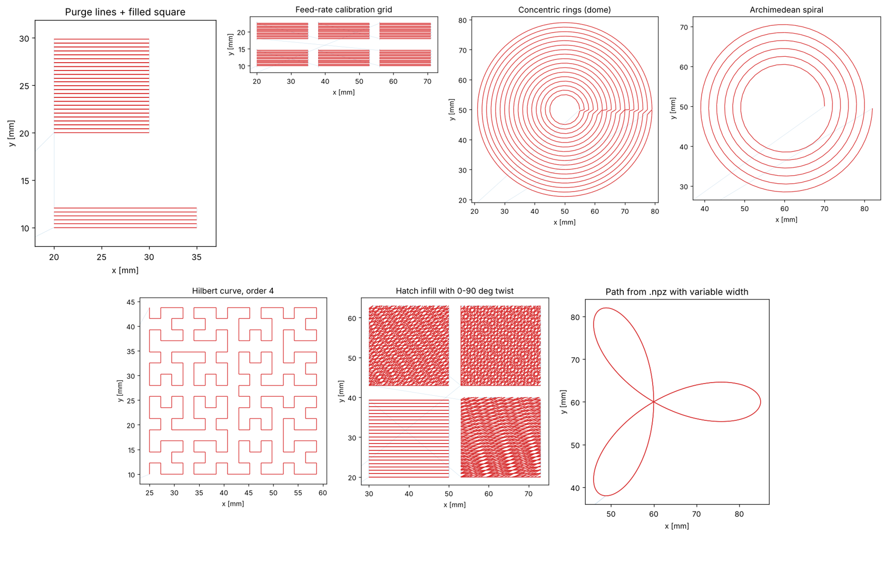
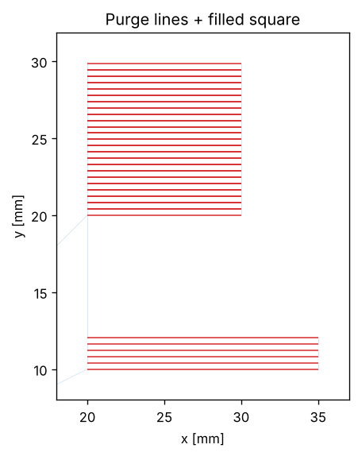
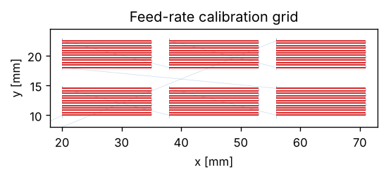
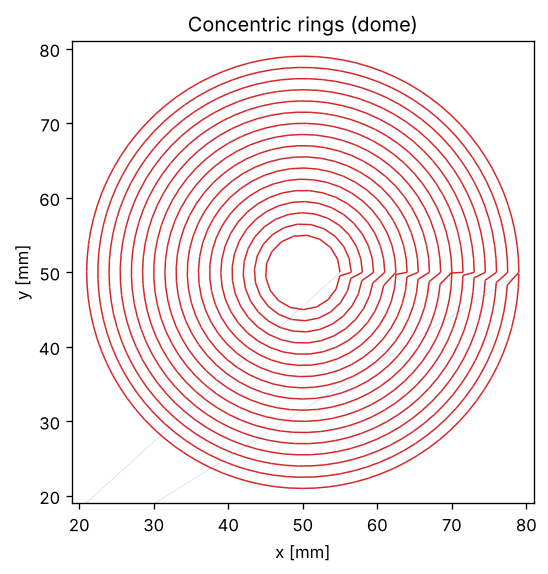
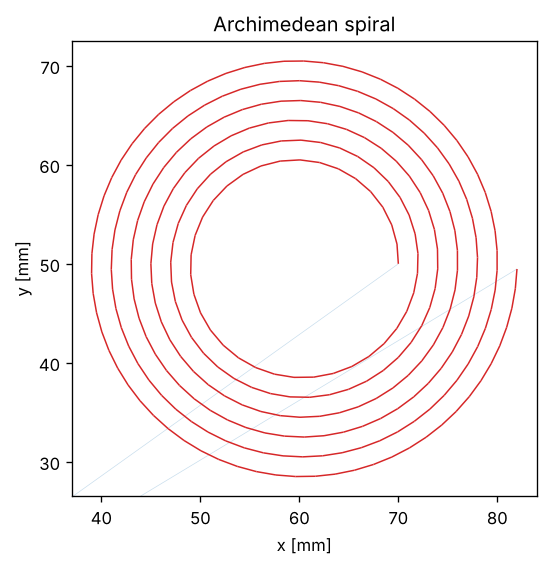
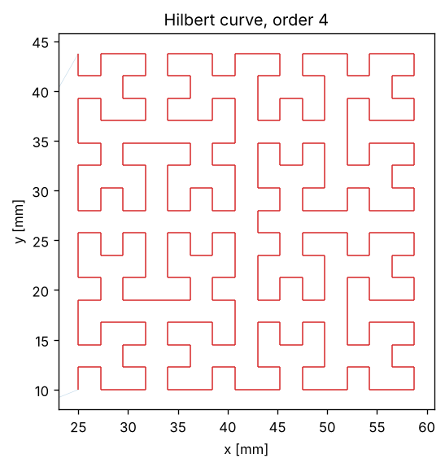
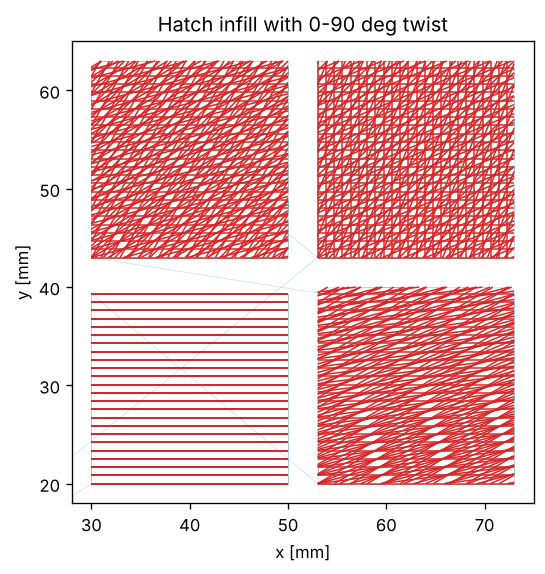
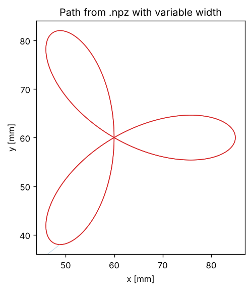

# py2gcode

Write G-code with Python. `py2gcode` is a small, single-file library for generating toolpaths for extrusion-based printers, built for **direct ink writing (DIW)** with syringe or paste extruders running **Klipper** or Marlin-style firmware.

Instead of slicing an STL, you describe the path yourself with NumPy: lines, rings, spirals, space-filling curves, hatch patterns, or paths loaded from a file. `py2gcode` handles the bookkeeping: absolute and relative moves, how much material to push for each segment, retraction, a 3D preview, and a material estimate.



## Features

- **One class, plain Python.** `move()` for relative moves and `move_abs()` for absolute moves, with `extrude=True` to print.
- **Automatic extrusion.** The E value for each segment is computed from the segment length, the line diameter and the syringe (or filament) diameter.
- **Variable line width.** Change `line_diameter` between moves to grade the bead width along a path.
- **Retraction** with `retract()` / `recover()`.
- **Raw commands** with `write()`, for anything printer-specific: Klipper macros, UV light pins, mixing ratios, comments.
- **Preview** with `plot()` (matplotlib 3D, travel moves in blue, extrusion in red).
- **Material report** with `material_report()`: plunger travel in mm and volume in mL.

## Installation

`py2gcode` is a single module. Clone the repository and put it on your path:

```bash
git clone https://github.com/AlejandroIbarraO/py2gcode.git
cd py2gcode
pip install numpy matplotlib
```

Then, from the repository folder (or with it on `PYTHONPATH`):

```python
from py2gcode import py2gcode
```

## Quick start

```python
import numpy as np
from py2gcode import py2gcode

p2c = py2gcode(material_diameter=12.4,   # syringe inner diameter [mm]
               nozzle_diameter=0.41)     # bead diameter [mm]
p2c.feed = 300          # printing speed [mm/min]
p2c.feednoprint = 600   # travel speed [mm/min]

p2c.write("G92 E0")                 # reset the extruder
p2c.move_abs(z=5)                   # travel up
p2c.move_abs(x=20, y=10)            # travel to the start
p2c.move_abs(z=0.2)                 # down to the first layer

for _ in range(5):                  # zig-zag of 5 lines, 15 mm long
    p2c.move(x=15, extrude=True)
    p2c.move(y=0.41)
    p2c.move(x=-15, extrude=True)
    p2c.move(y=0.41)

p2c.move_abs(z=5)
p2c.plot()                          # 3D preview
print(p2c.material_report())        # (plunger travel [mm], volume [mL])
p2c.output = "zigzag"
p2c.out()                           # writes zigzag.gcode
```

## How it works

### Extrusion model

Every extruding move pushes the plunger by

```
E = segment_length * (line_diameter / material_diameter)**2 * extrude_multiplier
```

This is volume conservation: a cylinder of material with diameter `material_diameter` (the syringe barrel or the filament) becomes a cylindrical bead with diameter `line_diameter`. `line_diameter` starts equal to `nozzle_diameter` and can be changed at any time.

For a flat bead of width `w` and layer height `h`, use the diameter of a circle with the same area:

```python
Da = np.sqrt(4 * w * h / np.pi)
p2c = py2gcode(material_diameter=12.4, nozzle_diameter=Da)
```

### Absolute and relative moves

- `move_abs(x, y, z, extrude=False, feed=None, extrude_multiplier=1.0)` emits `G90`/`M82` once when switching and then absolute coordinates with absolute E.
- `move(x, y, z, extrude=False, feed=None, extrude_multiplier=1.0)` emits `G91`/`M83` once when switching and then relative coordinates with relative E.

Mix them freely; the mode switch is inserted for you and the internal position is kept in sync. Non-extruding moves use `G0` at `feednoprint`, extruding moves use `G1` at `feed`, unless you pass `feed=`.

### Retraction

```python
p2c.retraction_lenght = 0.25   # mm of E
p2c.retraction_speed = 100.0   # mm/min
p2c.retract()   # G1 E-0.25
p2c.recover()   # G1 E+0.25
```

### Printer-specific commands

Anything that is not a move goes through `write()`. Some patterns from the lab setup:

```python
p2c.write("SET_PIN PIN=UVpin VALUE=0.1")   # Klipper: UV light on at 10 %
p2c.write("MIX_RATIO A=0.5 B=0.5")         # custom Klipper macro for a mixing head
p2c.write("M165 A0.5 B0.5")                # Marlin mixing extruder
p2c.write("; layer 2")                     # comment in the output
```

## API reference

| Member | Description |
|---|---|
| `py2gcode(material_diameter=12.5, nozzle_diameter=0.91, esteps=0)` | Create a generator. `esteps=1` switches to firmware-side flow (see below). |
| `move(x, y, z, extrude, feed, extrude_multiplier)` | Relative move. Omitted axes do not move. |
| `move_abs(x, y, z, extrude, feed, extrude_multiplier)` | Absolute move. |
| `retract()` / `recover()` | Pull back / push forward `retraction_lenght` at `retraction_speed`. |
| `write(command)` | Append any raw line of G-code. |
| `go_home()` | `G28 X0 Y0` then `G28 Z0`. |
| `set_zero(plane=True)` | `G92 X0 Y0` (or also `Z0`). |
| `set_head(T)`, `set_temp(head, tem)`, `set_bed_tem(tem)` | Tool change, nozzle temperature (`M109`), bed temperature (`M140`). |
| `pos(code='all')` | Current `[x, y, z]`, or one axis with `'x'`, `'y'` or `'z'`. |
| `plot(ax=None, fig=None)` | 3D preview of the path; returns `(fig, ax)`. |
| `material_report()` | `(E travel in mm, volume in mL)`, assuming `material_diameter` in mm. |
| `out(name=None)` | Write `<output>.gcode`, or `<name>.GCODE` if a name is given. |
| `clean_nozzle(extrude=True)` | Wipe line at `clean_position`, offset on every call. |

Main attributes: `feed`, `feednoprint` (mm/min), `line_diameter`, `nozzle_diameter`, `material_diameter`, `retraction_lenght`, `retraction_speed`, `output`, `command_history` (the list of G-code lines).

`esteps=1` targets custom firmware that computes the flow itself: moves carry `E1` and `e_config()` / `config_retraction()` emit the corresponding custom M-codes (`M221`, `M721`, `M722`, `M756`). With the default `esteps=0` everything is computed in Python and the output is standard G-code.

## Examples

All examples are in [`examples/`](examples) and run from any folder:

```bash
python examples/01_first_print.py           # writes examples/output/01_first_print.gcode (+ previews)
python examples/03_concentric_rings.py trumpet
python examples/04_archimedean_spiral.py --show   # also opens the matplotlib window
```

| # | Example | What it shows | Preview |
|---|---|---|---|
| 01 | [First print](examples/01_first_print.py) | Purge lines, filled square, two layers, retraction, effective bead diameter. |  |
| 02 | [Speed calibration](examples/02_speed_calibration.py) | Grid of patches at different feed rates; UV light control with `write()`. |  |
| 03 | [Concentric rings](examples/03_concentric_rings.py) | Line width graded with radius (`dome`, `trumpet`, `cone`) via `line_diameter`. |  |
| 04 | [Archimedean spiral](examples/04_archimedean_spiral.py) | One continuous path sampled at constant arc length; mixing-ratio macro. |  |
| 05 | [Hilbert curve](examples/05_hilbert_curve.py) | Space-filling infill from an L-system using relative moves. |  |
| 06 | [Hatch with twist](examples/06_hatch_twist.py) | Hatch infill at any angle, rotated layer by layer (0 to 90°). |  |
| 07 | [Path from file](examples/07_path_from_file.py) | Load a polyline and per-point width from `.npz` and print it. |  |

### Pattern file format (example 07)

```
point       float array (1, N, 3)   x, y, z of each vertex [mm]
point_data  float array (1, N)      line diameter at each vertex [mm]
```

```python
np.savez("my_pattern.npz", point=points[None], point_data=widths[None])
```

## Helper modules

| File | Purpose |
|---|---|
| `py2gcode.py` | The G-code generator. |
| `lines_pattern.py` | `generate_consecutive_hatch_lines(L, d, theta)`: zig-zag hatch lines filling an L × L square at angle `theta`. |
| `hilbert_curve.py` | `hilbert_curve(order)` and `translate(seq, output="vectors" \| "points")`. |

## Tips and known quirks

- Units are mm and mm/min (`feed = 600` is 10 mm/s).
- `material_report()` returns the volume in mL when `material_diameter` is in mm.
- The attribute is spelled `retraction_lenght` (with `ht`).
- Coordinates and E are rounded to 3 decimals. With a large syringe, very short **relative** extrusion moves can round to `E0`, so prefer `move_abs` for finely sampled curves (absolute E does not accumulate rounding error).
- `set_offset()` currently writes the X offset into Y as well.
- `plot()` draws every segment separately, so it gets slow for paths with tens of thousands of moves; use it on a subset when needed.

## License

_Add a license here (for example MIT) so others know how they can use the code._
